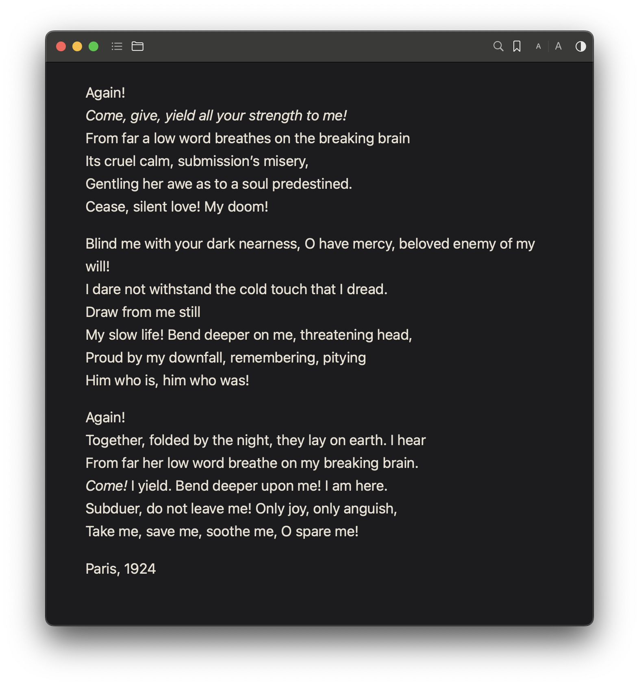
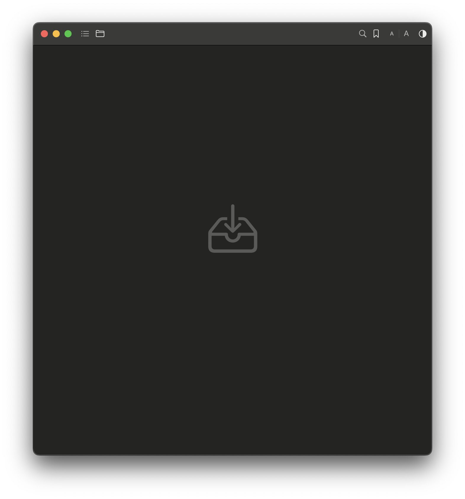
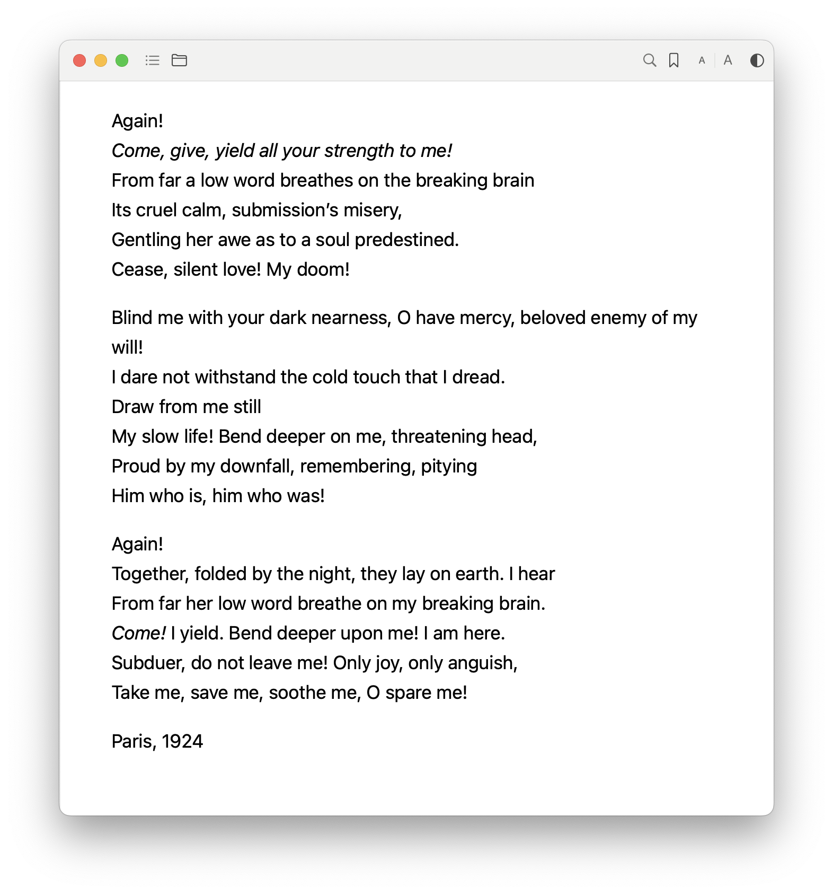
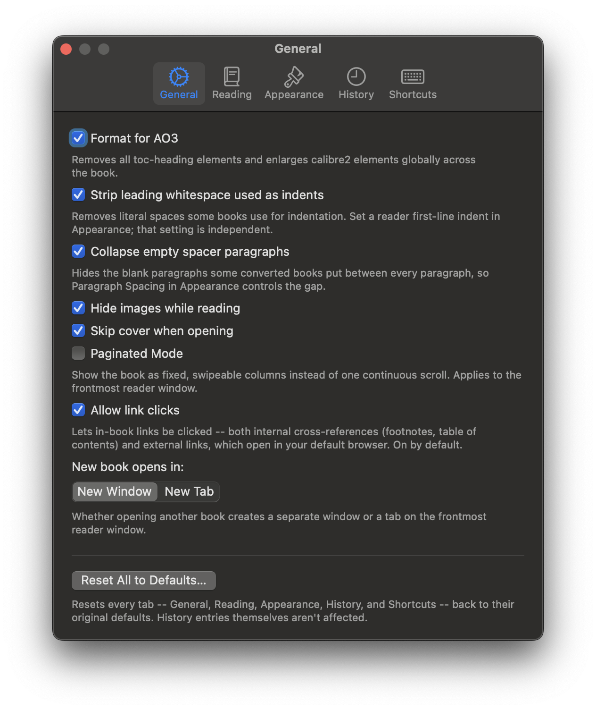

# Honeycrisp Reader

<p align="center">
  
</p>

<p align="center">
  <a href="https://github.com/kyrielie/honeycrisp/actions/workflows/tests.yml"></a>
  <a href="https://github.com/kyrielie/honeycrisp/releases/latest"></a>
  
  <a href="LICENSE"></a>
</p>

A native macOS EPUB standalone reader, inspired by this [EPUBQuickLook plugin](https://github.com/arytek/epub-quicklook-extension).

Built using claude and gemini and codex because I hate swift. 

Quick install: 
```bash
brew install --cask kyrielie/yggdrasil/honeycrisp
```

Check out https://github.com/kyrielie/ambrosia, a macos library and reader for massive fanfiction libraries. 
Also https://github.com/kyrielie/nectar its ios app companion reader.

## Screenshots

<p align="center">
  
</p>

<table>
<tr>
<td></td>
<td></td>
<td></td>
</tr>
</table>

## Installation

### Homebrew

```bash
brew install --cask kyrielie/yggdrasil/honeycrisp
```

Update with `brew upgrade --cask honeycrisp` once a tap update has been merged. See the
[Yggdrasil tap](https://github.com/kyrielie/homebrew-yggdrasil) for cask and release details.

### Manual download

Download the latest build from [Releases](https://github.com/kyrielie/honeycrisp/releases/latest)
and move it to Applications.

### First launch

Releases are ad-hoc signed and not notarized, so macOS Gatekeeper will block the first launch.
Either open **System Settings > Privacy & Security** and choose **Open Anyway**, or remove the
quarantine attribute:

```bash
xattr -d com.apple.quarantine /Applications/Honeycrisp.app
```

## Features

**Reading**
- Paginated mode: one spine document per page, with columns per screen configurable
- Scroll mode: all chapters merged into one continuous scroll, with auto-scroll
- Text to speech from the current reading position
- Themes: save preferred typography and colors as a named theme
- Light and dark appearance, following the system

**Navigation**
- Table of contents sidebar and popup
- In-book search with excerpts and chapter locations
- Start Reading follows EPUB landmarks when available
- Persistent bookmarks: toggle one per page, rename, and return from the Bookmarks menu
- Page counter (page / total pages, plus chapter / total chapters in paginated mode)

**Windows and files**
- Multiple windows or tabs, one book each
- Float on top: pin any window above all others
- Reading history and File > Open Recent
- Drag and drop an EPUB onto an empty reader window or an open book

The toolbar is customizable (View > Customize Toolbar), including the title and page counter.

## Non-goals

These are intentional scope boundaries, not missing features.

- **No library view.** File > Open, drag and drop, and the History popover are the only ways to open a book. See [ambrosia](https://github.com/kyrielie/ambrosia) for library management.
- **No cross-library full-text search.** Search covers the open book only.
- **Publisher styles are preserved.** Reader settings override the properties they own while book styling that carries meaning remains in place.
- **No per-window or per-book reading mode.** Paginated versus scroll is a single global default set in Settings > General.

## Keyboard shortcuts

Shortcuts marked configurable can be rebound in Settings > Shortcuts.

| Key | Action | Configurable |
|-----|--------|:------------:|
| ⌘O | Open EPUB file | Yes |
| ⌘F | Search in book | Yes |
| ⌘T | Show table of contents | Yes |
| ⇧⌘T | Float on top | Yes |
| ⇧⌘P | Toggle paginated mode | Yes |
| ⌘N | New window | No |
| ⌘W | Close window | No |
| ⌘+ / ⌘- | Increase / decrease font size | No |
| ← / → | Previous / next page (paginated mode) | No |
| ↑ / ↓ | Scroll (scroll mode) | No |
| Page Up / Page Down | Previous / next page or large scroll | No |

## Project documents

| Document | Purpose |
|---|---|
| [Architecture](ARCHITECTURE.md) | What the current code does |
| [Framework](docs/FRAMEWORK.md) | Target layers and contracts |
| [Roadmap](docs/ROADMAP.md) | Decisions, milestones, and implementation order |

## Development

Requirements: macOS 13+ to run; a Swift 5.9 toolchain (Xcode 15 or later) to build. CI runs on
Xcode 26.3. ZIPFoundation is fetched through Swift Package Manager.

```bash
brew install xcodegen
xcodegen generate
open Honeycrisp.xcodeproj
```

Select the **Honeycrisp** scheme and the **My Mac** destination, then press ⌘R. Set your own Team
under Signing & Capabilities if you see code signing errors.

`project.yml` is the source of truth for the generated Xcode project. Do not edit
`Honeycrisp.xcodeproj` by hand. The root `Package.swift` is a secondary SwiftPM entry point.

### Tests

```bash
./test.sh
```

The script generates the project and runs the unit tests. GitHub Actions does the same on pushes
and pull requests. Override the destination with `HONEYCRISP_TEST_DESTINATION` or the Derived Data
folder with `HONEYCRISP_DERIVED_DATA`.

### Linting

```bash
xcrun swift-format lint --configuration .swift-format --recursive Sources Tests
```

Format only the files you touch: `xcrun swift-format format --configuration .swift-format --in-place <file>`.
Formatting is a local check for now.

### Project documentation

- [ARCHITECTURE.md](ARCHITECTURE.md): design rationale and module responsibilities
- [INDEX.md](INDEX.md): file and section map for locating code
- [docs/ROADMAP.md](docs/ROADMAP.md): the plan, decisions and milestones
- [docs/FRAMEWORK.md](docs/FRAMEWORK.md): target design, layers and contracts
- [docs/compatibility-corpus.md](docs/compatibility-corpus.md): fixture map and real-file validation table

Local EPUB corpus files are excluded from source control unless their redistribution terms are
verified.

The QuickLook plugin (`EPUBQuickLook`) provided the `EPUBParser` core and the basic WebKit rendering approach. (I think, I just told claude to use it.)

## License

[MIT](LICENSE)
